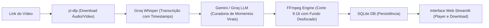

# ✂️ EasyKut — Cortador Automático de Vídeos Virais

O **EasyKut** é uma plataforma automatizada que transforma vídeos longos do YouTube em cortes curtos e verticais (formato 9:16), prontos para publicação no **TikTok, Instagram Reels e YouTube Shorts**.

O pipeline utiliza inteligência artificial generativa de ponta (**Groq Whisper**, **Google Gemini** e **Groq LLM**) para analisar transcrições com timestamps precisos, identificar ganchos e momentos de alta retenção, e renderizar clipes em alta definição com fundo desfocado via **FFmpeg**.

---

## 🚀 Arquitetura & Fluxo de Funcionamento



1. **Entrada de URL:** O usuário informa o link de um vídeo no YouTube / Shorts.
2. **Download Otimizado:** O `yt-dlp` extrai os metadados e baixa o áudio leve (MP3 64k) e o vídeo em MP4 (1080p/720p).
3. **Transcrição de Alta Precisão:** O áudio é transcrito via API Groq com o modelo `whisper-large-v3-turbo`, gerando timestamps frase a frase.
4. **Curadoria Inteligente:** O texto estruturado com tempos é enviado ao Google Gemini (`gemini-3.1-flash-lite`) ou Groq LLM com o prompt especializado de Diretor de Cortes, que retorna títulos chamativos, scores de viralidade e intervalos ideais de corte.
5. **Renderização Vertical (9:16):** O motor FFmpeg recorta os intervalos selecionados aplicando o filtro de fundo desfocado com sobreposição centralizada nítida.
6. **Persistência & Visualização:** Os dados e cortes são registrados no SQLite (`data/cortador.db`) e disponibilizados para pré-visualização e download na interface Streamlit.

---

## 🛠️ Tecnologias Utilizadas

- **Interface:** [Streamlit](https://streamlit.io/)
- **Download de Mídia:** [yt-dlp](https://github.com/yt-dlp/yt-dlp)
- **Renderização e Edição de Vídeo:** [FFmpeg](https://ffmpeg.org/) & [OpenCV](https://opencv.org/)
- **Inteligência Artificial:**
  - **Transcrição de Áudio:** [Groq Cloud](https://console.groq.com) (`whisper-large-v3-turbo`)
  - **Curadoria e Análise Viral:** [Google GenAI Gemini](https://aistudio.google.com) (`gemini-3.1-flash-lite`) e Groq LLMs
- **Banco de Dados:** SQLite3 (Modo WAL habilitado para concorrência)

---

## 📦 Como Executar o Projeto

### 1. Pré-requisitos
- Python 3.10 ou superior.
- [FFmpeg](https://ffmpeg.org/download.html) instalado no sistema (ex: `C:\ffmpeg\bin` no Windows).

### 2. Configurar Variáveis de Ambiente
Copie o arquivo de exemplo `.env.example` para `.env`:
```bash
cp .env.example .env
```
Preencha suas chaves no `.env`:
```env
GROQ_API_KEY=sua_chave_groq_aqui
GEMINI_API_KEY=sua_chave_gemini_aqui
```

### 3. Instalar Dependências
```bash
pip install -r requirements.txt
```

### 4. Iniciar a Aplicação
Execute o comando do Streamlit a partir da pasta `cortador_automatico`:
```bash
streamlit run app.py
```
Acesse a aplicação no seu navegador em `http://localhost:8501`.

---

## 🧪 Testes Automatizados

Para testar a camada de persistência e banco de dados:
```bash
python test_db.py
```
