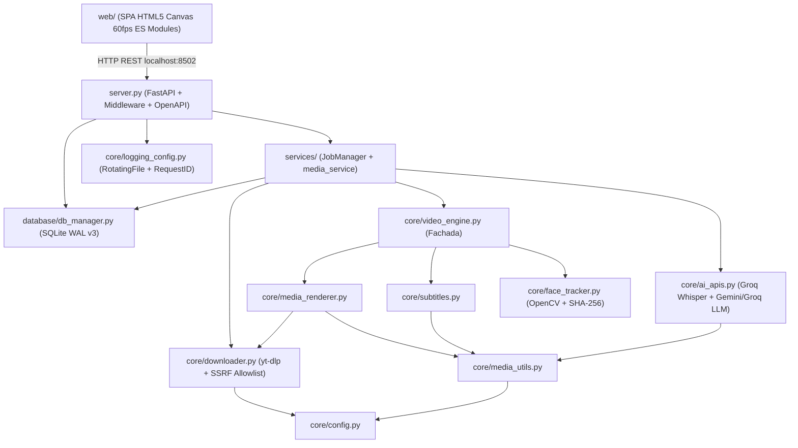

# Arquitetura do Repositório — EasyKut Studio (v3.1)

Este documento descreve a arquitetura em camadas, o fluxo de dependências (DAG), o modelo de dados SQLite, os provedores de IA, o motor audiovisual e os controles de segurança/observabilidade implementados na versão **3.1** do **EasyKut Studio**.

---

## 1. Visão Arquitetural em Camadas

O sistema adota uma separação clara em camadas sem dependências circulares (`DAG`):

### Responsabilidade das Camadas

- **`web/` (Apresentação — ES Modules sem bundler):**
  - `web/index.html` + `web/styles.css`: SPA Dark Studio com abas *Estúdio* (Master-Detail + Mockup 9:16) e *Biblioteca*.
  - `web/app.js`: Orquestração de estado, polling resiliente, player de clipe, auto-save com debounce (`PATCH /api/cortes/{id}`) e construção segura de DOM (`createElement`/`textContent`).
  - `web/js/utils.js`: Sanitização (`escapeHtml`, `getSafeCutDownloadUrl`), formatadores e `debounce`.
  - `web/js/api.js`: Cliente HTTP centralizado para `/api/*`.
  - `web/js/canvas_engine.js`: Engine 60fps de arraste/redimensionamento proporcional e desfoque otimizado via canvas offscreen reduzido (`270×480` + cache estático para frames parados).
- **`server.py` (Camada HTTP FastAPI):**
  - Contratos Pydantic estritos (`Literal`, `Field`, `model_validator`, `response_model` OpenAPI).
  - Middleware local de segurança (`ALLOWED_HOSTS`, `ALLOWED_ORIGINS` contra DNS rebinding/CSRF, cabeçalhos `nosniff`/`DENY`/`same-origin`) e correlação (`X-Request-ID`).
  - Endpoints assíncronos retornando `202 Accepted` (`/api/analyze`, `/api/render`), observabilidade (`GET /api/health`) e limpeza (`POST /api/cleanup`).
- **`services/` (Orquestração & Estado):**
  - `services/job_manager.py`: `JobManager` thread-safe com controle de concorrência (`HTTP 429`), semáforo FFmpeg, `deepcopy` em leitura e evicção TTL/LRU para `jobs` e `analyses_cache`.
  - `services/media_service.py`: Resolução confiável de fontes (`resolve_trusted_video_source`), esteira de análise com extração paralela de frames (`ThreadPoolExecutor(max_workers=2)`) e esteira de renderização com persistência de edições.
- **`core/` (Domínio & Integrações):**
  - `config.py`, `logging_config.py`, `media_utils.py`, `downloader.py`, `ai_apis.py`, `subtitles.py`, `face_tracker.py`, `media_renderer.py` e fachada `video_engine.py`.
- **`database/` (Persistência):**
  - `database/db_manager.py`: SQLite WAL, migrations idempotentes via `PRAGMA user_version = 3`, constraints `CHECK`, 4 índices secundários e consultas em lote sem N+1.

---

## 2. Banco de Dados (`data/cortador.db` — Schema v3)

- **Engine:** SQLite 3 (`PRAGMA journal_mode = WAL`, `PRAGMA foreign_keys = ON`, `timeout = 15.0`, caminho determinístico `_resolve_db_path`).
- **Migrations Versionadas (`PRAGMA user_version = 3`):**
  - **v2:** Adição idempotente de `tipo`, `layout_mode`, `layout_params` (JSON), `burn_subtitles` e `updated_at` (com backfill).
  - **v3:** Criação de 4 índices secundários: `idx_cortes_video_id`, `idx_cortes_virality_score`, `idx_videos_created_at`, `idx_videos_url`.
- **Tabelas:**
  1. `videos`: `id`, `url`, `title`, `duration CHECK (>= 0)`, `file_path`, `audio_path`, `status`, `created_at`, `updated_at`.
  2. `cortes`: `id`, `video_id (FK ON DELETE CASCADE)`, `title`, `start_time CHECK (>= 0)`, `end_time CHECK (> start_time)`, `duration (VIRTUAL)`, `virality_score CHECK (0..100)`, `justification`, `tipo`, `layout_mode`, `layout_params`, `burn_subtitles`, `output_path`, `status`, `created_at`, `updated_at`.
- **Operações CRUD:** `init_db`, `add_video`, `get_video`, `update_video_status`, `list_videos`, `list_videos_with_cortes` (lote sem N+1 + paginação), `delete_video`, `add_corte`, `get_corte`, `list_cortes`, `update_corte`, `update_corte_status`, `delete_corte`, `save_analysis` (atômico com recuperação de vídeo pai). Exclusões físicas são confinadas a `DATA_DIR`.

---

## 3. Inteligência Artificial (`core/ai_apis.py`)

- **Transcrição:** Groq Whisper (`whisper-large-v3-turbo`, `response_format="verbose_json"`, timeout de 60s, recompressão FFmpeg <24 MB, retry exponencial).
- **Curadoria de Cortes Virais (`prompts/diretor_cortes.txt`):**
  - **Google Gemini:** `gemini-3.8-flash` → `gemini-3.5-flash-lite` → `gemini-3.1-flash-lite` (timeout `60000ms`).
  - **Groq LLM:** `openai/gpt-oss-120b` → `openai/gpt-oss-20b` → `qwen/qwen3.8-27b` (timeout `60.0s`).
  - **Fallback & Diagnóstico:** Falhas `404` avançam imediatamente para o próximo modelo; se o provedor primário falhar, chaveia para o secundário e agrega erros individuais por modelo.

---

## 4. Segurança, Observabilidade e CI/CD

- **Segurança (OWASP):** Allowlist pública + bloqueio SSRF/DNS rebinding; `-protocol_whitelist file,http,https,tcp,tls` + validação contra LFI/argument injection no FFmpeg; transcrições isoladas em `data/cache/` fora do `StaticFiles`; verificação SHA-256 do binário `face_detection_yunet_2023mar.onnx`; proteção anti-XSS no DOM.
- **Observabilidade:** `GET /api/health` (`200`/`503`), `RotatingFileHandler` em `data/logs/easykut.log` (5 MB × 5 backups) e `X-Request-ID` / `job_id` propagados via `ContextVar`.
- **Qualidade & CI:** `.github/workflows/ci.yml` executando `ruff`, `bandit -ll`, `pip-audit`, `node --check` e `pytest` (67 testes isolados em `tests/`).

---

## 5. Diretrizes de Versionamento

- **Fluxo Git `main`-only:** Todo o desenvolvimento ocorre diretamente na branch `main`.
