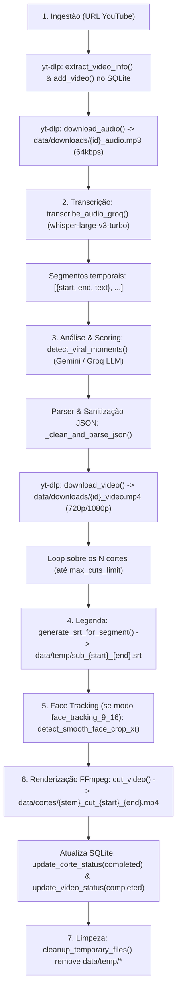

# Documentação Técnica — EasyKut (v1.0)

Este documento descreve de forma exata a arquitetura, os módulos, o fluxo de dados ponta a ponta, o esquema do banco de dados SQLite, os mecanismos de resiliência e as regras de ambiente atualmente implementados na versão **1.0** do **EasyKut**.

---

## 1. Árvore Real de Arquivos e Responsabilidade dos Módulos

```text
cortador_automatico/
├── .env                          # Variáveis de ambiente locais (GROQ_API_KEY, GEMINI_API_KEY)
├── .env.example                  # Template de variáveis de ambiente
├── .gitignore                    # Exclusões do controle de versão (venv/, .env, data/, *.db, etc.)
├── app.py                        # Aplicação Web Streamlit (UI, estado da esteira e histórico)
├── iniciar_easykut.bat           # Launcher Windows 1-click (libera porta 8502 e usa Python da venv)
├── requirements.txt              # Dependências Python do projeto
├── README.md                     # Guia rápido de instalação e uso
├── test_db.py                    # Teste de integração da camada SQLite
├── test_fase2.py                 # Teste CLI da esteira de transcrição e análise IA
├── test_fase3.py                 # Teste CLI de geração SRT, Face Tracking e renderização FFmpeg
├── .streamlit/
│   └── config.toml               # Configuração local do servidor Streamlit
├── core/
│   ├── __init__.py               # Fachada pública exportando funções e constantes do pacote core
│   ├── config.py                 # Gerenciamento de caminhos, auto-descoberta do FFmpeg e validação de chaves
│   ├── downloader.py             # Integração com yt-dlp para metadados, áudio MP3 (64k) e vídeo MP4
│   ├── ai_apis.py                # Integração com Groq Whisper, Google Gemini e Groq LLMs com fallback e retry
│   └── video_engine.py           # Motor de vídeo: Face Tracking OpenCV 4/5, gerador SRT, filtros FFmpeg e limpeza
├── database/
│   ├── __init__.py               # Fachada pública exportando funções CRUD do banco
│   └── db_manager.py             # Gerenciador SQLite3 com modo WAL e integridade referencial (CASCADE)
├── data/
│   ├── cortador.db               # Arquivo de banco de dados SQLite
│   ├── downloads/                # Arquivos brutos baixados ({id}_audio.mp3 e {id}_video.mp4)
│   ├── cortes/                   # Clipes finais renderizados ({stem}_cut_{start}_{end}.mp4)
│   ├── models/                   # Pesos de detecção facial (face_detection_yunet_2023mar.onnx)
│   └── temp/                     # Legendas temporárias (sub_{start}_{end}.srt) e artefatos de teste
├── docs/
│   ├── arquitetura.md            # Visão geral arquitetural e histórico das 5 fases
│   └── documentacao_tecnica.md   # Este documento técnico detalhado
└── prompts/
    └── diretor_cortes.txt        # System prompt de engenharia de retenção e formato JSON estrito
```

### Responsabilidade Detalhada por Módulo

| Módulo / Arquivo | Responsabilidade Técnica |
| :--- | :--- |
| `app.py` | Ponto de entrada da interface gráfica em Streamlit. Renderiza o painel de controle lateral (diagnóstico de chaves/FFmpeg, seleção de modelo IA, modo de enquadramento, toggle de legendas, resolução 720p/1080p, limite de cortes e limpeza manual) e duas abas principais: **Processar Novo Vídeo** (esteira de 6 etapas com barra de progresso e galeria de download) e **Histórico & Cortes Salvos** (listagem do SQLite, player embutido e exclusão em cascata). |
| `core/config.py` | Injeta automaticamente diretórios conhecidos do FFmpeg (`C:\ffmpeg\bin`, `C:\Ghost Toolbox\wget\Youtube-DLP`, `C:\ProgramData\chocolatey\bin`) na variável `os.environ["PATH"]`. Define e cria as pastas `DATA_DIR`, `DOWNLOADS_DIR`, `CUTS_DIR` e `PROMPTS_DIR`. Carrega o arquivo `.env` de forma determinística e disponibiliza `validate_config()` para verificar `GROQ_API_KEY`, `GEMINI_API_KEY` e `FFMPEG_AVAILABLE`. |
| `core/downloader.py` | Valida URLs com regex (`is_valid_video_url`), sanitiza nomes de arquivos (`sanitize_filename`), consulta metadados sem baixar mídia (`extract_video_info`), baixa áudio comprimido em MP3 64kbps via pós-processador `FFmpegExtractAudio` (`download_audio`) e baixa o vídeo em MP4 limitado à altura máxima escolhida (`download_video`). |
| `core/ai_apis.py` | Gerencia clientes autenticados da Groq (`get_groq_client`) e Google GenAI (`get_gemini_client`). Executa a transcrição com timestamps via `transcribe_audio_groq` (`whisper-large-v3-turbo`), formata a transcrição em linhas `[MM:SS - MM:SS (start -> end)] texto` (`format_transcript_with_timestamps`), realiza a curadoria viral via Gemini (`analyze_viral_cuts_gemini`) ou Groq (`analyze_viral_cuts_groq`) sob orientação de `prompts/diretor_cortes.txt`, orquestra o chaveamento automático entre provedores (`detect_viral_moments`) e sanitiza o JSON retornado (`_clean_and_parse_json`). |
| `core/video_engine.py` | Valida binários (`check_ffmpeg`), extrai metadados técnicos via `ffprobe` (`get_video_metadata`), converte segundos em timestamp SRT (`format_srt_time`), gera legendas `.srt` ajustadas para `00:00:00,000` (`generate_srt_for_segment`), executa rastreamento facial compatível com OpenCV 4 e 5 (`_FaceDetectorWrapper` e `detect_smooth_face_crop_x`), monta e executa a linha de comando FFmpeg para os 4 modos de corte (`cut_video`), gera thumbnails JPEG (`extract_frame_thumbnail`) e remove arquivos temporários (`cleanup_temporary_files`). |
| `database/db_manager.py` | Gerencia conexões SQLite (`get_connection`) com `timeout=15.0`, `check_same_thread=False`, `PRAGMA foreign_keys = ON` e `PRAGMA journal_mode = WAL`. Cria as tabelas `videos` e `cortes` (`init_db`) e implementa todas as operações CRUD (`add_video`, `get_video`, `update_video_status`, `list_videos`, `delete_video`, `add_corte`, `list_cortes`, `update_corte_status`, `save_analysis`). |
| `prompts/diretor_cortes.txt` | Define as regras de negócio de curadoria: gancho forte nos primeiros 3–5 segundos, contexto autossuficiente, duração alvo de 20 a 90 segundos (ideal 30–60s), eliminação de vácuos, avaliação de `virality_score` (1 a 10) e saída obrigatória em JSON puro com a chave `"cortes"`. |
| `iniciar_easykut.bat` | Script Batch Windows que posiciona o diretório de trabalho em `%~dp0`, encerra processos existentes na porta `8502` via PowerShell (`Get-NetTCPConnection` + `Stop-Process`), valida a existência de `venv\Scripts\python.exe` e executa o Streamlit isolado na porta `8502`. |

---

## 2. Fluxo de Dados Ponta a Ponta



### Detalhamento das 7 Etapas do Pipeline

1. **Ingestão (`core/downloader.py`):**
   - A URL informada é validada por `is_valid_video_url()`.
   - `extract_video_info()` coleta `id`, `title`, `duration`, `thumbnail`, `uploader` e `view_count` sem baixar o vídeo.
   - O registro inicial é criado na tabela `videos` com `status="processing"`.
   - `download_audio()` baixa a melhor faixa de áudio e a converte em `data/downloads/{id}_audio.mp3` (64kbps) para reduzir latência de upload na API de transcrição. O status no banco avança para `"transcribing"`.

2. **Transcrição (`core/ai_apis.py`):**
   - `transcribe_audio_groq()` envia o binário `.mp3` para a Groq Cloud utilizando o modelo `whisper-large-v3-turbo` com `response_format="verbose_json"`, `language="pt"` e `temperature=0.0`.
   - Os segmentos retornados são normalizados em uma lista de dicionários `{"start": float, "end": float, "text": str}`.

3. **Análise e Scoring Viral (`core/ai_apis.py`):**
   - `format_transcript_with_timestamps()` converte os segmentos no formato textual `[MM:SS - MM:SS (start.s -> end.s)] Texto`.
   - `detect_viral_moments()` combina o conteúdo de `prompts/diretor_cortes.txt` com a transcrição e consulta o provedor selecionado:
     - **Primário (Gemini):** modelo `gemini-3.1-flash-lite` com `response_mime_type="application/json"` e `temperature=0.3`.
     - **Alternativo / Fallback (Groq):** modelo `openai/gpt-oss-120b` (com fallback interno imediato para `qwen/qwen3.8-27b`) com `response_format={"type": "json_object"}` e `temperature=0.3`.
   - `_clean_and_parse_json()` remove blocos markdown (` ```json `), decodifica o JSON (ou recupera via regex em caso de malformação) e filtra apenas cortes válidos com duração mínima de **5.0 segundos** (`end - start >= 5.0`).

4. **Face Tracking e Estabilização (`core/video_engine.py`):**
   - Após o download do vídeo em alta resolução (`download_video()`), se o modo selecionado for `face_tracking_9_16`, `cut_video()` calcula a largura do recorte 9:16 proporcional à altura original (`crop_w = int(orig_h * (9.0 / 16.0))`, ajustado para número par) e aciona `detect_smooth_face_crop_x()`.
   - O vídeo é amostrado a cada `0.25s` (`sample_rate_sec=0.25`) no intervalo `[start_time, end_time]`.
   - Cada frame lido é reduzido pela metade (`scale_factor=0.5`) para acelerar a inferência no `_FaceDetectorWrapper`.
   - **Priorização do Maior Rosto:** Quando múltiplos rostos são detectados no mesmo frame, o algoritmo seleciona o rosto de maior área (`w * h`), priorizando o falante em primeiro plano.
   - **Amortecimento (Damping) e Média Móvel:** Para impedir saltos bruscos de câmera quando há troca de interlocutor, o deslocamento máximo por amostra é limitado a 25% da largura do corte (`max_step = crop_w * 0.25`). A coordenada `target_x` resultante alimenta uma fila `deque(maxlen=10)` (Média Móvel de 10 frames).
   - Ao final do trecho, calcula-se a **mediana** (`np.median`) de todas as médias móveis coletadas, garantindo uma coordenada `final_x` par e estável para o filtro `crop` do FFmpeg.

5. **Legenda Sincronizada (`core/video_engine.py`):**
   - Quando `burn_subtitles=True`, `generate_srt_for_segment()` filtra todos os segmentos do Whisper que intersectam o intervalo `[start_time, end_time]`.
   - Os tempos são deslocados para o referencial do corte (`rel_start = max(0.0, seg_start - start_time)` e `rel_end = min(end_time - start_time, seg_end - start_time)`), fazendo a legenda começar exatamente a partir de `00:00:00,000`.
   - O arquivo é salvo em `data/temp/sub_{int(start_time)}_{int(end_time)}.srt`.
   - `_format_ffmpeg_subtitles_filter()` escapa o caminho do Windows (`C\:/caminho/...`) e aplica `force_style` com `FontName=Arial,Bold=1,PrimaryColour=&H00FFFFFF,OutlineColour=&H00000000,BorderStyle=1,Outline=2,Alignment=2`, variando `FontSize=16,MarginV=55` (vertical 9:16) ou `FontSize=18,MarginV=25` (horizontal 16:9).

6. **Renderização (`core/video_engine.py`):**
   - `cut_video()` executa o `ffmpeg` via `subprocess.run` com corte rápido na entrada (`-ss` e `-t`) e aplica o filtro correspondente ao modo:
     - `face_tracking_9_16`: `-vf crop={crop_w}:{orig_h}:{face_x}:0,scale=1080:1920[,subtitles=...]`
     - `crop_center`: `-vf crop=ih*(9/16):ih,scale=1080:1920[,subtitles=...]`
     - `blur_background`: `-filter_complex [0:v]scale=1080:1920:force_original_aspect_ratio=increase,crop=1080:1920,boxblur=25:10[bg];[0:v]scale=1080:1920:force_original_aspect_ratio=decrease[fg];[bg][fg]overlay=(W-w)/2:(H-h)/2[merged]...`
     - `horizontal_16_9`: `-vf scale={min(orig_w, 1920)}:-2[,subtitles=...]`
   - A saída é codificada com `-c:v libx264 -preset fast -crf 22 -c:a aac -b:a 128k -pix_fmt yuv420p -movflags +faststart` e salva em `data/cortes/`.

7. **Limpeza (`core/video_engine.py`):**
   - Ao concluir a esteira (ou via botão manual na barra lateral), `cleanup_temporary_files()` varre `data/temp/` (e opcionalmente `data/downloads/` se `remove_raw_downloads=True`), excluindo arquivos temporários (exceto `.gitkeep`) e retornando a contagem de arquivos removidos e megabytes liberados.

---

## 3. Esquema Real das Tabelas do SQLite (`data/cortador.db`)

O banco de dados SQLite é inicializado por `database/db_manager.py` com as seguintes diretivas de conexão:
- `timeout = 15.0` segundos
- `check_same_thread = False` (compatibilidade com múltiplas threads de sessão do Streamlit)
- `PRAGMA foreign_keys = ON;`
- `PRAGMA journal_mode = WAL;` (Write-Ahead Logging)

### 3.1. Tabela `videos`

Armazena os vídeos principais submetidos na plataforma.

```sql
CREATE TABLE IF NOT EXISTS videos (
    id INTEGER PRIMARY KEY AUTOINCREMENT,
    url TEXT NOT NULL,
    title TEXT DEFAULT '',
    duration REAL DEFAULT 0.0,
    file_path TEXT DEFAULT '',
    audio_path TEXT DEFAULT '',
    status TEXT DEFAULT 'pending',
    created_at TIMESTAMP DEFAULT CURRENT_TIMESTAMP,
    updated_at TIMESTAMP DEFAULT CURRENT_TIMESTAMP
);
```

| Coluna | Tipo | Padrão | Descrição |
| :--- | :--- | :--- | :--- |
| `id` | `INTEGER` | `AUTOINCREMENT` | Chave primária do vídeo. |
| `url` | `TEXT` | Obrigatório (`NOT NULL`) | URL original do vídeo no YouTube. |
| `title` | `TEXT` | `''` | Título extraído via `yt-dlp`. |
| `duration` | `REAL` | `0.0` | Duração total do vídeo original em segundos. |
| `file_path` | `TEXT` | `''` | Caminho absoluto do vídeo MP4 baixado em `data/downloads/`. |
| `audio_path` | `TEXT` | `''` | Caminho absoluto do áudio MP3 baixado em `data/downloads/`. |
| `status` | `TEXT` | `'pending'` | Estado atual (`pending`, `processing`, `transcribing`, `analyzed`, `cutting`, `completed`, `completed_no_cuts`, `failed`). |
| `created_at` | `TIMESTAMP` | `CURRENT_TIMESTAMP` | Data/hora de criação do registro. |
| `updated_at` | `TIMESTAMP` | `CURRENT_TIMESTAMP` | Data/hora da última atualização de status. |

### 3.2. Tabela `cortes` (Clipes Gerados)

Armazena os cortes sugeridos pela IA e renderizados pelo FFmpeg para cada vídeo. Possui relacionamento `1:N` com `videos` e exclusão automática em cascata (`ON DELETE CASCADE`).

```sql
CREATE TABLE IF NOT EXISTS cortes (
    id INTEGER PRIMARY KEY AUTOINCREMENT,
    video_id INTEGER NOT NULL,
    title TEXT DEFAULT '',
    start_time REAL NOT NULL,
    end_time REAL NOT NULL,
    duration REAL GENERATED ALWAYS AS (end_time - start_time) VIRTUAL,
    virality_score REAL DEFAULT 0.0,
    justification TEXT DEFAULT '',
    output_path TEXT DEFAULT '',
    status TEXT DEFAULT 'pending',
    created_at TIMESTAMP DEFAULT CURRENT_TIMESTAMP,
    FOREIGN KEY (video_id) REFERENCES videos (id) ON DELETE CASCADE
);
```

| Coluna | Tipo | Padrão | Descrição |
| :--- | :--- | :--- | :--- |
| `id` | `INTEGER` | `AUTOINCREMENT` | Chave primária do corte. |
| `video_id` | `INTEGER` | Obrigatório (`NOT NULL`) | Chave estrangeira referenciando `videos(id)` com `ON DELETE CASCADE`. |
| `title` | `TEXT` | `''` | Título magnético sugerido pela IA para o corte. |
| `start_time` | `REAL` | Obrigatório (`NOT NULL`) | Tempo inicial do corte em segundos no vídeo original. |
| `end_time` | `REAL` | Obrigatório (`NOT NULL`) | Tempo final do corte em segundos no vídeo original. |
| `duration` | `REAL VIRTUAL` | `end_time - start_time` | Coluna virtual calculada automaticamente pelo SQLite. |
| `virality_score` | `REAL` | `0.0` | Nota de potencial de viralização atribuída pela IA (escala 0 a 10). |
| `justification` | `TEXT` | `''` | Justificativa gerada pela IA explicando a escolha do trecho. |
| `output_path` | `TEXT` | `''` | Caminho absoluto do arquivo `.mp4` renderizado em `data/cortes/`. |
| `status` | `TEXT` | `'pending'` | Estado do corte (`pending`, `rendering`, `completed`). |
| `created_at` | `TIMESTAMP` | `CURRENT_TIMESTAMP` | Data/hora de registro do corte. |

---

## 4. Mecanismos de Resiliência Implementados

1. **Retentativas Automáticas com Backoff Exponencial (`core/ai_apis.py`):**
   - Todas as chamadas externas para **Groq Whisper**, **Google Gemini** e **Groq LLMs** executam até `3` tentativas (`max_retries=3`).
   - Em caso de erro de rede, timeout ou limite de taxa (`HTTP 429`), o sistema aguarda `wait_time = base_delay * (2 ** attempt)` segundos (`2s`, `4s`, `8s`) antes de tentar novamente.

2. **Fallback Cruzado de Provedores e Modelos de IA (`core/ai_apis.py`):**
   - Na função `detect_viral_moments()`, se o provedor primário escolhido pelo usuário (**Gemini**) falhar após todas as retentativas, o sistema chaveia automaticamente para a **Groq** (e vice-versa).
   - Dentro de `analyze_viral_cuts_groq()`, se o modelo principal `openai/gpt-oss-120b` falhar, a mesma tentativa aciona imediatamente o modelo alternativo `qwen/qwen3.8-27b`.

3. **Sanitização e Recuperação de JSON por Regex (`_clean_and_parse_json`):**
   - Remove cercas de código Markdown (` ```json ... ``` `) caso o LLM as inclua.
   - Se `json.loads()` falhar por truncamento ou erro de sintaxe da IA, um extrator de expressão regular (`re.findall`) varre o texto bruto capturando cada objeto com `title`, `start_time`, `end_time`, `virality_score` e `justification`, reconstruindo a lista de cortes sem interromper a esteira.

4. **Compatibilidade Dinâmica OpenCV 4.x e OpenCV 5.x (`_FaceDetectorWrapper`):**
   - Verifica dinamicamente via `hasattr(cv2, "CascadeClassifier")` antes de instanciar o classificador Haar Cascade (padrão no OpenCV 4.x), evitando o `AttributeError` no OpenCV 5.x (onde o módulo legado foi removido).
   - Caso `CascadeClassifier` não esteja disponível, utiliza automaticamente `cv2.FaceDetectorYN` com o modelo ONNX YuNet (`data/models/face_detection_yunet_2023mar.onnx`, baixando-o automaticamente do OpenCV Zoo caso ausente) ou `cv2.dnn` (Caffe SSD).
   - **Fallback Seguro para Center Crop 9:16:** Se nenhum detector/modelo puder ser carregado, se ocorrer qualquer exceção durante a leitura de frames ou se nenhum rosto aparecer no trecho, `detect_smooth_face_crop_x()` retorna `None` e `cut_video()` aplica silenciosamente o recorte centralizado (`face_x = (orig_w - crop_w) // 2`), garantindo que a renderização no Streamlit nunca quebre.

5. **Garbage Collector de Temporários e Exclusão Física no Histórico:**
   - Executado automaticamente ao final de cada processamento (quando o checkbox *"Limpeza automática pós-processamento"* está ativo) ou sob demanda pelo botão na sidebar.
   - Remove arquivos `.srt` e mídias intermediárias em `data/temp/` tratando erros de permissão individualmente (`try/except` por arquivo).
   - Na exclusão pelo Histórico (`delete_video`), remove com segurança tanto as entradas relacionais do SQLite quanto os arquivos de mídia físicos (`.mp4` e `.mp3`) do disco.

6. **Proteção de Quota e Payload da API Groq Whisper (`core/ai_apis.py`):**
   - O áudio é extraído nativamente em mono 16kHz a 48kbps via `yt-dlp`, reduzindo o peso em mais de 60%.
   - Caso um áudio longo ultrapasse 24 MB (margem de segurança do limite de 25 MB da Groq), o sistema aciona uma recompressão rápida em segundo plano para 24kbps mono antes do upload, eliminando erros `413 Payload Too Large`.

7. **Aceleração da Amostragem Facial no OpenCV (`core/video_engine.py`):**
   - Substituição de buscas demuxadas repetitivas (`cap.set`) por leitura sequencial otimizada com `cap.grab()` nos frames intermediários, acelerando a fase de rastreamento facial em até 4x sem travar o processamento.

8. **Persistência de Sessão da Galeria no Streamlit (`app.py`):**
   - Os cortes renderizados e metadados são salvos em `st.session_state`, garantindo que downloads sucessivos ou interações na interface não façam a galeria desaparecer da tela.

---

## 5. Regras de Ambiente e Git

1. **Restrição de Versão do OpenCV (`opencv-python<5`):**
   - O arquivo `requirements.txt` especifica `opencv-python<5` para priorizar a série `4.x` (que inclui `cv2.CascadeClassifier` e os XMLs nativos em `cv2.data.haarcascades`), enquanto `core/video_engine.py` mantém suporte híbrido para OpenCV 4.x e 5.x.
2. **Inicialização Isolada via Ambiente Virtual (`python -m streamlit`):**
   - O projeto deve ser executado exclusivamente invocando o interpretador da virtualenv local (`venv\Scripts\python.exe -m streamlit run app.py --server.port 8502`), conforme automatizado pelo `iniciar_easykut.bat`. Isso evita conflitos com instalações globais do Python no Windows ou portas presas em execuções anteriores.
3. **Fluxo Git `main`-only:**
   - Todo o desenvolvimento, correções e evoluções são realizados **sempre direto na branch `main`**. Não devem ser criadas branches de feature ou homologação.
