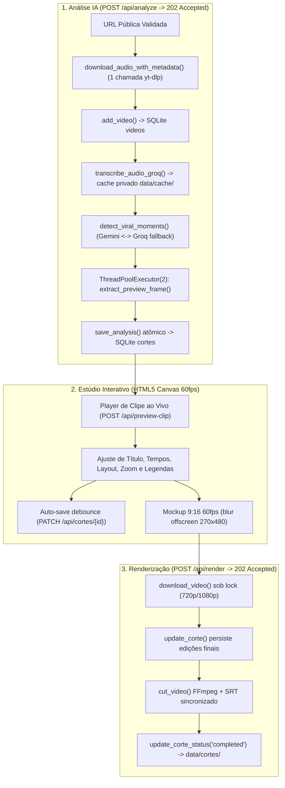

# Documentação Técnica — EasyKut Studio (v3.1)

Especificação técnica completa da arquitetura, endpoints REST, schema SQLite v3, pipeline de mídia/IA, controles de segurança, observabilidade e automação de CI/CD do **EasyKut Studio v3.1**.

---

## 1. Estrutura de Módulos e Responsabilidades

| Módulo / Arquivo | Responsabilidade Técnica |
| :--- | :--- |
| `server.py` | Camada HTTP FastAPI: rotas REST tipadas com `response_model`, middleware anti-DNS-rebinding/CSRF + `X-Request-ID`, GC de startup (>24h) e mounts estáticos (`/data/temp`, `/data/cortes`, `/`). |
| `services/job_manager.py` | `JobManager` thread-safe gerenciando fila de jobs, limites de concorrência (`MAX_CONCURRENT_ANALYZE_JOBS=2`, `MAX_CONCURRENT_RENDER_JOBS=2`), semáforo FFmpeg (`Semaphore(2)`), `deepcopy` em leitura e evicção TTL/LRU. |
| `services/media_service.py` | Orquestração da esteira de análise (`run_analyze_job` com extração paralela de frames via `ThreadPoolExecutor(max_workers=2)`), renderização (`run_render_job` persistindo edições do Studio) e `resolve_trusted_video_source`. |
| `core/config.py` | Carregamento determinístico do `.env`, criação de diretórios (`data/downloads`, `data/cortes`, `data/cache`, `data/logs`), auto-descoberta de FFmpeg/cookies e alerta preventivo contra arquivos de credenciais redundantes. |
| `core/logging_config.py` | Configuração idempotente de console + `RotatingFileHandler` (`data/logs/easykut.log`, 5 MB × 5 backups, UTF-8) com filtro `RequestIdFilter` (`ContextVar`). |
| `core/media_utils.py` | `validate_ffmpeg_input_target`, `is_path_within`, `check_ffmpeg`, `FFMPEG_ALLOWED_PROTOCOLS` e `normalize_virality_score` (normalização única 0–100). |
| `core/downloader.py` | Allowlist de domínios públicos (`youtube.com`, `youtu.be`, `vimeo.com`, `twitch.tv`) com validação DNS/IP contra SSRF, extração unificada `download_audio_with_metadata`, `socket_timeout=30` e `_download_video_lock`. |
| `core/ai_apis.py` | Clientes Groq (`timeout=60.0`) e Gemini (`HttpOptions(timeout=60000)`), Whisper com compressão <24 MB, fallback entre modelos/provedores, retry exponencial e parser/recuperação regex de JSON. |
| `core/subtitles.py` | `format_srt_time`, `generate_srt_for_segment` (relativo a `00:00:00,000`) e `format_ffmpeg_subtitles_filter` com escape seguro para `libavfilter` (`\:`, `\'`, `\[`, `\]`, `\,`, `\;`). |
| `core/face_tracker.py` | `_FaceDetectorWrapper` (Haar Cascade / YuNet ONNX / Caffe DNN), validação SHA-256 obrigatória no binário `face_detection_yunet_2023mar.onnx` e `detect_smooth_face_crop_x` com `try/finally` liberando `cv2.VideoCapture`. |
| `core/media_renderer.py` | `get_video_metadata`, `extract_preview_frame`, `extract_preview_clip`, `draw_framing_preview` (confinado a `DATA_DIR`), `cut_video` (4 layouts FFmpeg com UTF-8) e `cleanup_temporary_files(..., max_age_hours=...)`. |
| `core/video_engine.py` | Fachada retrocompatível que re-exporta os submódulos especializados sem acoplamento circular. |
| `database/db_manager.py` | SQLite WAL com `PRAGMA foreign_keys = ON`, migrations versionadas (`PRAGMA user_version = 3`), constraints `CHECK`, 4 índices secundários, CRUD completo de `videos` e `cortes`, `list_videos_with_cortes` (sem N+1) e exclusão física confinada. |
| `web/app.js` + `web/js/*.js` | SPA ES Modules (`utils.js`, `api.js`, `canvas_engine.js`, `app.js`): Canvas 60fps com blur offscreen 270×480, player de clipe ao vivo, DOM seguro anti-XSS, polling resiliente e auto-save com debounce. |
| `prompts/diretor_cortes.txt` | Diretrizes editoriais para curadoria viral (shorts de 5s a 180s, longos ≥420s, análise em 3 níveis e saída JSON pura). |

---

## 2. Fluxo Ponta a Ponta (Assíncrono com Estúdio 60fps)



---

## 3. Especificação dos Endpoints REST (`server.py`)

| Método | Endpoint | Status | Descrição Técnica |
| :--- | :--- | :---: | :--- |
| `GET` | `/api/health` | `200` / `503` | Healthcheck operacional (`db_ok`, `ffmpeg_available`, `disk_free_mb`, `active_jobs`). |
| `GET` | `/api/config` | `200` | Status booleano das chaves (`GROQ_API_KEY`, `GEMINI_API_KEY`, `FFMPEG_AVAILABLE`, `COOKIES_TXT`) e provedor padrão. |
| `POST` | `/api/analyze` | `202` / `400` / `422` / `429` | Valida URL pública, cria job em background e retorna `JobAcceptedResponse` (`job_id`, `message`). |
| `GET` | `/api/jobs/{job_id}` | `200` / `404` | Retorna snapshot (`copy.deepcopy`) com `status` (`running`/`completed`/`error`), `step`, `progress`, `result` e `error`. |
| `POST` | `/api/frame` | `200` / `400` / `429` | Extrai 1 frame JPEG a partir de fonte cadastrada (`video_id`), protegido por semáforo FFmpeg. |
| `POST` | `/api/preview-clip` | `200` / `400` / `429` | Gera clipe leve `.mp4` 720p com áudio para prévia em tempo real no Canvas. |
| `POST` | `/api/render` | `202` / `400` / `404` / `422` / `429` | Inicia renderização assíncrona dos cortes selecionados e retorna `JobAcceptedResponse`. |
| `GET` | `/api/history` | `200` | Lista vídeos paginados (`?search=&min_score=&limit=50&offset=0`) em lote sem N+1; retorna total em `X-Total-Count`. |
| `DELETE` | `/api/history/{video_id}` | `200` / `404` | Exclui vídeo, cortes em cascata, cache em memória e opcionalmente arquivos físicos confinados (`?delete_files=true`). |
| `GET` | `/api/cortes/{corte_id}` | `200` / `404` | Retorna metadados completos de um corte com `layout_params` desserializado e `video_url`. |
| `PATCH` | `/api/cortes/{corte_id}` | `200` / `400` / `404` / `422` | Atualização parcial de `title`, `start_time`, `end_time`, `tipo`, `layout_mode`, `layout_params` e `burn_subtitles`. |
| `DELETE` | `/api/cortes/{corte_id}` | `200` / `404` | Exclui um corte individual e opcionalmente seu `.mp4` confinado a `DATA_DIR` (`?delete_file=true`). |
| `POST` | `/api/cleanup` | `200` | Executa GC em `data/temp/` (e opcionalmente `data/downloads/`) respeitando `max_age_hours` + poda TTL/LRU em memória. |
| `POST` | `/api/open-folder` | `200` | Abre `data/cortes/` no Explorador de Arquivos do Windows. |

---

## 4. Esquema SQLite v3 (`data/cortador.db`)

```sql
CREATE TABLE IF NOT EXISTS videos (
    id INTEGER PRIMARY KEY AUTOINCREMENT,
    url TEXT NOT NULL,
    title TEXT DEFAULT '',
    duration REAL DEFAULT 0.0 CHECK (duration >= 0.0),
    file_path TEXT DEFAULT '',
    audio_path TEXT DEFAULT '',
    status TEXT DEFAULT 'pending',
    created_at TIMESTAMP DEFAULT CURRENT_TIMESTAMP,
    updated_at TIMESTAMP DEFAULT CURRENT_TIMESTAMP
);

CREATE TABLE IF NOT EXISTS cortes (
    id INTEGER PRIMARY KEY AUTOINCREMENT,
    video_id INTEGER NOT NULL,
    title TEXT DEFAULT '',
    start_time REAL NOT NULL CHECK (start_time >= 0.0),
    end_time REAL NOT NULL CHECK (end_time > start_time),
    duration REAL GENERATED ALWAYS AS (end_time - start_time) VIRTUAL,
    virality_score REAL DEFAULT 0.0 CHECK (virality_score >= 0.0 AND virality_score <= 100.0),
    justification TEXT DEFAULT '',
    tipo TEXT DEFAULT 'short',
    layout_mode TEXT DEFAULT 'vertical_blur',
    layout_params TEXT DEFAULT '{}',
    burn_subtitles INTEGER DEFAULT 1,
    output_path TEXT DEFAULT '',
    status TEXT DEFAULT 'pending',
    created_at TIMESTAMP DEFAULT CURRENT_TIMESTAMP,
    updated_at TIMESTAMP DEFAULT CURRENT_TIMESTAMP,
    FOREIGN KEY (video_id) REFERENCES videos (id) ON DELETE CASCADE
);

-- Índices criados na migration v3 (PRAGMA user_version = 3)
CREATE INDEX IF NOT EXISTS idx_cortes_video_id ON cortes (video_id);
CREATE INDEX IF NOT EXISTS idx_cortes_virality_score ON cortes (virality_score);
CREATE INDEX IF NOT EXISTS idx_videos_created_at ON videos (created_at DESC, id DESC);
CREATE INDEX IF NOT EXISTS idx_videos_url ON videos (url);
```

---

## 5. Segurança, Supply Chain e CI/CD

1. **Controles HTTP Locais:** CORS restrito a `http://127.0.0.1:8502` e `http://localhost:8502` (`allow_credentials=False`); bloqueio de `Host` fora da allowlist (anti-DNS rebinding) e de `Origin` cross-origin em métodos mutáveis (`POST`/`PUT`/`PATCH`/`DELETE` → `403`); headers `X-Content-Type-Options: nosniff`, `X-Frame-Options: DENY`, `Referrer-Policy: same-origin` e `X-Request-ID`.
2. **Proteção de Mídia & Arquivos:** Validação SSRF/LFI em `downloader.py` e `media_utils.py`, `-protocol_whitelist file,http,https,tcp,tls`, confinamento estrito em `DATA_DIR` para prévias e exclusões físicas, e transcrições segregadas em `data/cache/` fora do `StaticFiles`.
3. **Supply Chain:** Dependências pinadas em `requirements.txt` e `requirements-dev.txt`, `iniciar_easykut.bat` sem auto-update implícito (opt-in `--update-ytdlp`) e checksum SHA-256 verificado para `face_detection_yunet_2023mar.onnx`.
4. **Pipeline CI (`.github/workflows/ci.yml`):** Executa em `push`/`pull_request` na `main`:
   - `ruff check core database services server.py tests`
   - `bandit -c pyproject.toml -r core database services server.py -ll`
   - `pip-audit -r requirements.txt`
   - `node --check` em `web/js/*.js` e `web/app.js`
   - `pytest` (suíte isolada em `tests/`)
