# Documentação Técnica — EasyKut Studio (v3.0)

Este documento descreve de forma exata a arquitetura, os módulos, os endpoints REST do servidor FastAPI, a interface SPA local (`web/`), o fluxo de dados ponta a ponta, o esquema do banco de dados SQLite, os mecanismos de resiliência e as regras de ambiente implementados na versão **3.0** do **EasyKut Studio**.

---

## 1. Árvore Real de Arquivos e Responsabilidade dos Módulos

```text
cortador_automatico/
├── .env                          # Variáveis de ambiente locais (GROQ_API_KEY, GEMINI_API_KEY)
├── .env.example                  # Template de variáveis de ambiente
├── .gitignore                    # Exclusões do controle de versão (venv/, .env, data/, *.db, etc.)
├── server.py                     # Servidor Web Local FastAPI (Rotas REST, background jobs e arquivos estáticos)
├── app.py                        # Interface legado Streamlit (mantida para compatibilidade retroativa)
├── iniciar_easykut.bat           # Launcher Windows 1-click (libera porta 8502, sobe Uvicorn e abre navegador)
├── requirements.txt              # Dependências Python (FastAPI, Uvicorn, yt-dlp, FFmpeg, OpenCV, etc.)
├── README.md                     # Guia rápido de instalação e uso do EasyKut Studio
├── test_db.py                    # Teste de integração da camada SQLite
├── test_fase2.py                 # Teste CLI da esteira de transcrição e análise IA
├── test_fase3.py                 # Teste CLI de geração SRT, Face Tracking e renderização FFmpeg
├── web/
│   ├── index.html                # Estrutura semântica SPA (Topbar, Hero, Master-Detail Workspace, Library e Modal)
│   ├── styles.css                # Identidade visual Dark Studio (#0B0D12, #141821, #6366F1), tipografia Inter e Phone Mockup
│   └── app.js                    # Motor gráfico HTML5 Canvas (60fps), arraste/redimensionamento proporcional e cliente REST API
├── .streamlit/
│   └── config.toml               # Configuração local do servidor Streamlit
├── core/
│   ├── __init__.py               # Fachada pública exportando funções e constantes do pacote core
│   ├── config.py                 # Gerenciamento de caminhos, auto-descoberta do FFmpeg e validação de chaves
│   ├── downloader.py             # Integração com yt-dlp para metadados, streaming direto, áudio MP3 e vídeo MP4
│   ├── ai_apis.py                # Integração com Groq Whisper, Google Gemini e Groq LLMs com fallback e retry
│   └── video_engine.py           # Motor de vídeo: 4 modos de layout, preview visual, gerador SRT e limpeza
├── database/
│   ├── __init__.py               # Fachada pública exportando funções CRUD do banco
│   └── db_manager.py             # Gerenciador SQLite3 com modo WAL e integridade referencial (CASCADE)
├── data/
│   ├── cortador.db               # Arquivo de banco de dados SQLite
│   ├── downloads/                # Arquivos brutos baixados ({id}_audio.mp3 e {id}_video.mp4)
│   ├── cortes/                   # Clipes finais renderizados ({stem}_cut_{start}_{end}.mp4)
│   ├── models/                   # Pesos de detecção facial (face_detection_yunet_2023mar.onnx)
│   └── temp/                     # Frames de prévia (.jpg), legendas (.srt) e cache de transcrição
├── docs/
│   ├── arquitetura.md            # Visão geral arquitetural e histórico das fases
│   └── documentacao_tecnica.md   # Este documento técnico detalhado
└── prompts/
    └── diretor_cortes.txt        # System prompt de engenharia de retenção e formato JSON estrito
```

### Responsabilidade Detalhada por Módulo

| Módulo / Arquivo | Responsabilidade Técnica |
| :--- | :--- |
| `server.py` | Servidor Web Local construído em **FastAPI**. Substitui o Streamlit como núcleo do frontend, fornecendo endpoints REST assíncronos (`/api/config`, `/api/analyze`, `/api/jobs/{id}`, `/api/frame`, `/api/frame/preview`, `/api/render`, `/api/history`, `/api/open-folder`), gerenciamento de background jobs em threads independentes para evitar timeouts, e montagem estática de `/web` (SPA) e `/data` (mídias). |
| `web/index.html` | Estrutura semântica da SPA moderna sem build/Node.js: Topbar fixa, aba Estúdio com Hero Input centralizado, Workspace Master-Detail (lista compacta de cortes, palco central com editor HTML5 Canvas e coluna de prévia final com mockup de smartphone) e aba Biblioteca. |
| `web/styles.css` | Folha de estilos Dark Studio Profissional: paleta grafite (`#0B0D12`, `#141821`, `#232938`), acentos em Índigo (`#6366F1`) e Âmbar (`#F59E0B`), tipografia Inter, scrollbars customizadas e mockup de smartphone 9:16 com notch superior. |
| `web/app.js` | Motor de aplicação e renderização gráfica em **HTML5 Canvas a 60fps**: controle de arraste e redimensionamento proporcional travado no mouse para Recorte Manual (9:16) e Split-Screen (1080x960 cada), espelhamento ao vivo no mockup do celular, integração REST e gestão de jobs. |
| `app.py` | Interface legada em Streamlit mantida para compatibilidade com fluxos legados da V2.0. |
| `core/config.py` | Injeta automaticamente diretórios conhecidos do FFmpeg (`C:\ffmpeg\bin`, `C:\Ghost Toolbox\wget\Youtube-DLP`, `C:\ProgramData\chocolatey\bin`) na variável `os.environ["PATH"]`. Define e cria as pastas `DATA_DIR`, `DOWNLOADS_DIR`, `CUTS_DIR` e `PROMPTS_DIR`. Carrega o arquivo `.env` de forma determinística e disponibiliza `validate_config(provider)` com validação flexível (exigindo `GROQ_API_KEY` + `FFMPEG` como base, e `GEMINI_API_KEY` apenas se Gemini for selecionado). |
| `core/downloader.py` | Valida URLs com regex (`is_valid_video_url`), sanitiza nomes de arquivos (`sanitize_filename`), consulta metadados sem baixar mídia (`extract_video_info`), obtém URLs diretas de stream HTTP sem download prévio via yt-dlp (`get_direct_stream_url`), extrai frames rápidos remotos/locais (`extract_preview_frame`), baixa áudio comprimido em MP3 48kbps via pós-processador `FFmpegExtractAudio` (`download_audio`) e baixa o vídeo em MP4 limitado à resolução escolhida (`download_video`). |
| `core/ai_apis.py` | Gerencia clientes autenticados da Groq (`get_groq_client`) e Google GenAI (`get_gemini_client`). Executa a transcrição com timestamps via `transcribe_audio_groq` (`whisper-large-v3-turbo`), formata a transcrição em linhas `[MM:SS - MM:SS (start -> end)] texto` (`format_transcript_with_timestamps`), realiza a curadoria viral via Gemini (`analyze_viral_cuts_gemini`) ou Groq (`analyze_viral_cuts_groq`) sob orientação de `prompts/diretor_cortes.txt`, orquestra o chaveamento automático entre provedores (`detect_viral_moments`) e sanitiza o JSON retornado (`_clean_and_parse_json`), normalizando scores (0–100) e tipo (`short` / `longo`). |
| `core/video_engine.py` | Valida binários (`check_ffmpeg`), extrai metadados técnicos via `ffprobe` (`get_video_metadata`), converte segundos em timestamp SRT (`format_srt_time`), gera legendas `.srt` ajustadas para `00:00:00,000` (`generate_srt_for_segment`) com escape estrito de caracteres especiais (`:, ', [, ], ,`), extrai frames únicos com fast seek (`extract_preview_frame`), gera prévias visuais de enquadramento com OpenCV/Pillow (`draw_framing_preview`), executa rastreamento facial compatível com OpenCV 4 e 5 (`_FaceDetectorWrapper` e `detect_smooth_face_crop_x`), gerencia os 4 modos de layout e renderização FFmpeg (`cut_video`), gera thumbnails JPEG (`extract_frame_thumbnail`) e remove arquivos temporários (`cleanup_temporary_files`). |
| `database/db_manager.py` | Gerencia conexões SQLite (`get_connection`) com `timeout=15.0`, `check_same_thread=False`, `PRAGMA foreign_keys = ON` e `PRAGMA journal_mode = WAL`. Cria as tabelas `videos` e `cortes` (`init_db`) e implementa todas as operações CRUD (`add_video`, `get_video`, `update_video_status`, `list_videos`, `delete_video` com exclusão opcional de arquivos físicos via `delete_files=False`, `add_corte`, `list_cortes`, `update_corte_status`, `save_analysis`). |
| `prompts/diretor_cortes.txt` | Define as regras de curadoria viral: gancho magnético nos primeiros 3–5 segundos, contexto autossuficiente, eliminação de vácuos, pontuação estrita de `virality_score` de 0 a 100, classificação de `tipo` ("short" até 3 min ou "longo" 7+ min) e saída em JSON puro compatível com `core/ai_apis.py`. |
| `iniciar_easykut.bat` | Script Batch Windows que posiciona o diretório de trabalho em `%~dp0`, encerra processos existentes na porta `8502` via PowerShell (`Get-NetTCPConnection` + `Stop-Process`), valida `venv\Scripts\python.exe`, abre o navegador padrão em `http://127.0.0.1:8502` e inicia o servidor Uvicorn FastAPI. |

---

## 2. Fluxo de Dados Ponta a Ponta (Fluxo em 2 Passos com Estúdio de Enquadramento)

```mermaid
flowchart TD
    subgraph Passo1["Passo 1: Ingestão, Curadoria de IA e Captura de Prévias"]
        A["URL do YouTube"] --> B["yt-dlp: extract_video_info() & add_video()"]
        B --> C["yt-dlp: download_audio() -> MP3 48kbps mono 16kHz"]
        C --> D["Groq Whisper: transcribe_audio_groq()"]
        D --> E["IA Generativa: detect_viral_moments() (Gemini / Groq)"]
        E --> F["Ordenação por virality_score decrescente (0–100)"]
        F --> G["yt-dlp + FFmpeg: extract_preview_frame() para cada corte"]
        G --> H["Persistência em st.session_state['analise_atual'] & save_analysis()"]
    end

    subgraph Estudio["Passo 1.5: Estúdio de Enquadramento em Tempo Real"]
        H --> I["Expander individual por corte com Score e Duração"]
        I --> J["Seleção de Modo: Vertical Blur, Horizontal 16:9, Manual 9:16, Split-Screen ou Face Tracking"]
        J --> K["Sliders interativos (Zoom, Posição X/Y %, Caixas Topo e Base)"]
        K --> L["draw_framing_preview() gera prévia visual renderizada ao vivo"]
        L --> M["Botão 'Atualizar Frame' sincronizado com novos tempos de início/fim"]
    end

    subgraph Passo2["Passo 2: Renderização dos Cortes Selecionados"]
        M --> N["Botão: Renderizar Cortes Selecionados"]
        N --> O["yt-dlp: download_video() em 720p/1080p (apenas sob demanda)"]
        O --> P["Loop sobre cortes marcados (selected=True)"]
        P --> Q["Geração SRT ajustada para 00:00:00,000 (generate_srt_for_segment)"]
        Q --> R["FFmpeg: renderização com layout_mode e layout_params específicos"]
        R --> S["Atualiza SQLite (update_corte_status) e salva em st.session_state['ultimos_cortes']"]
    end

    subgraph Galeria["Galeria Persistente"]
        S --> T["Renderização fora de blocos condicionais: player e download seguro sem recarga vazia"]
    end
```



### Detalhamento das Etapas do Pipeline

1. **Passo 1 — Ingestão, Curadoria e Prévias Iniciais:**
   - O usuário insere a URL do YouTube e clica em **"🔍 Analisar Vídeo & Extrair Prévias"**.
   - O `yt-dlp` coleta metadados (`extract_video_info`) e registra o vídeo no SQLite com `status="processing"`.
   - Baixa exclusivamente a faixa de áudio leve (`download_audio`) em mono 16kHz (48kbps), minimizando tempo e payload.
   - `transcribe_audio_groq` transcreve o áudio com `whisper-large-v3-turbo` na nuvem Groq.
   - `detect_viral_moments` analisa os momentos magnéticos e ganchos com **Gemini** ou **Groq LLM**.
   - Os cortes são calibrados na escala `0–100`, classificados como `"short"` ou `"longo"` e ordenados de forma decrescente pelo `virality_score`.
   - Para cada corte sugerido, `extract_preview_frame()` obtém a URL direta de streaming via `yt-dlp` e captura 1 frame real no timestamp do corte em ~1.5s, armazenando-o para alimentar o Estúdio.
   - Todos os dados são consolidados em `st.session_state["analise_atual"]` e registrados no banco SQLite.
   - O feedback em tempo real é fornecido via `st.status(..., expanded=True)`.

2. **Passo 1.5 — Estúdio de Enquadramento em Tempo Real (HTML5 Canvas 60fps):**
   - **Workspace Master-Detail:**
     - **Coluna Esquerda (280px):** Lista compacta de cortes sugeridos com cards táteis contendo checkbox de seleção, badge de score de viralidade (`0–100`), título e duração formatada. Ao clicar em qualquer corte, ele se torna o corte ativo em edição no palco central.
     - **Palco Central (Canvas Interativo):** Canvas HTML5 de alto desempenho desenhando o frame real do vídeo com suporte completo a arraste e redimensionamento proporcional travado no mouse:
       - **16:9 Original:** Preserva o widescreen nativo original sem corte nem distorção.
       - **9:16 Sem Zoom (Blur):** Centraliza o vídeo original com proporção intacta sobre canvas 1080x1920 com fundo desfocado + escurecido e slider suave de aproximação (zoom 1.0x a 1.3x).
       - **Recorte Manual:** Desenha 1 caixa arrastável e redimensionável diretamente com o cursor do mouse sobre o frame real, travada rigorosamente na proporção 9:16 com 4 alças de canto (`NW, NE, SW, SE`).
       - **Split-Screen:** Desenha 2 caixas independentes arrastáveis e redimensionáveis: Caixa Topo (Índigo `#6366F1`, falante 1) e Caixa Base (Âmbar `#F59E0B`, falante 2), cada uma travada na proporção 9:8 (1080x960).
     - **Coluna Direita (Mockup de Smartphone 9:16 ao Vivo):** Segundo canvas (`#mockup-canvas`) embutido em um mockup de celular com notch que espelha em tempo real a 60fps exatamente como o vídeo final ficará enquanto o usuário arrasta as caixas com o mouse.
   - Os controles do topo permitem editar o título, ajustar milimetricamente os segundos de início/fim, ligar/desligar legendas queimadas e clicar em **"🔄 Atualizar Frame"** para recarregar o frame instantaneamente no novo instante.

3. **Passo 2 — Renderização Sob Demanda via FFmpeg:**
   - Ao acionar **"🎬 Renderizar Cortes Selecionados"**, o sistema baixa o vídeo fonte em alta definição (`download_video`, 720p ou 1080p) apenas se ainda não existir localmente.
   - Itera exclusivamente pelos cortes marcados (`selected=True`), acionando `cut_video()` com o `layout_mode` e `layout_params` definidos pelo usuário no Estúdio.
   - Quando as legendas estão ativadas, gera legendas sincronizadas (`00:00:00,000`) e aplica o filtro de queima com escape estrito de caracteres especiais (`:, ', [, ], ,`).
   - Atualiza o status de cada corte no SQLite para `completed` e salva os registros em `st.session_state["ultimos_cortes"]`.

4. **Galeria Persistente pós-rerun:**
   - A galeria de vídeos renderizados é renderizada no fluxo principal fora de blocos condicionais de botões.
   - O botão de download utiliza descritores de arquivos diretos, permitindo baixar múltiplos clipes sem que o rerun do Streamlit faça a galeria desaparecer.

5. **Aba de Histórico Aprimorada:**
   - **Abertura Rápida de Pasta:** Botão *"📂 Abrir Pasta de Cortes"* que invoca `os.startfile(CUTS_DIR)` no Windows (ou `explorer` como fallback), abrindo `data/cortes/` no Explorador de Arquivos com 1 clique.
   - **Busca e Filtragem:** Campo de busca textual por título/URL e slider de nota mínima de 0 a 100 com normalização automática para cortes legados.
   - **Exclusão com Limpeza Física:** Opção *"Apagar também os arquivos .mp4 do disco"* conectada a `delete_video(video_id, delete_files=True)` para remover os arquivos de vídeo e áudio do disco e do SQLite simultaneamente.
   - **Otimização de RAM:** O download de clipes históricos transmite diretamente o descritor de arquivo aberto (`typing.BinaryIO`), eliminando o consumo excessivo de memória RAM por alocação de bytes inteiros (`.read()`).

6. **Prévia de Frame Real e Enquadramento (`core/video_engine.py` e `core/downloader.py`):**
   - `extract_preview_frame(source, timestamp_sec)`: Extrai 1 único frame JPEG no timestamp informado. Para links do YouTube, `get_direct_stream_url` obtém a URL direta de stream HTTP via `yt-dlp` (`download=False`), permitindo ao FFmpeg buscar e salvar o frame em ~1.5s sem baixar o vídeo previamente.
   - `draw_framing_preview(frame_path, mode, params)`: Gera a renderização visual do enquadramento sobre o frame:
     - `manual_crop`: desenha o retângulo 9:16 com máscara atenuada ao redor (área externa escurecida a 45%).
     - `split_screen`: desenha duas caixas de seleção independentes (Topo: Ciano/Azul claro e Base: Laranja/Amarelo), cada uma com aspecto 1.125 para 1080x960.
     - `vertical_blur`: gera o canvas 9:16 (1080x1920) com fundo desfocado (`GaussianBlur 51x51`), levemente escurecido (`brightness=-0.15`) e vídeo nítido centralizado em proporção nativa (com `zoom_factor` de 1.0 a 1.3).
     - `horizontal_16_9`: retorna o frame widescreen 16:9 original em alta definição.

7. **Face Tracking e Estabilização (`core/video_engine.py`):**
   - Disponível como preset opcional de recorte. Quando acionado, `detect_smooth_face_crop_x()` calcula a largura do recorte 9:16 proporcional à altura original (`crop_w = int(orig_h * (9.0 / 16.0))`, ajustado para número par).
   - O vídeo é amostrado a cada `0.25s` (`sample_rate_sec=0.25`) no intervalo `[start_time, end_time]`.
   - Cada frame lido é reduzido pela metade (`scale_factor=0.5`) para acelerar a inferência no `_FaceDetectorWrapper`.
   - **Priorização do Maior Rosto:** Quando múltiplos rostos são detectados no mesmo frame, o algoritmo seleciona o rosto de maior área (`w * h`), priorizando o falante em primeiro plano.
   - **Amortecimento (Damping) e Média Móvel:** Para impedir saltos bruscos de câmera quando há troca de interlocutor, o deslocamento máximo por amostra é limitado a 25% da largura do corte (`max_step = crop_w * 0.25`). A coordenada `target_x` resultante alimenta uma fila `deque(maxlen=10)` (Média Móvel de 10 frames).
   - Ao final do trecho, calcula-se a **mediana** (`np.median`) de todas as médias móveis coletadas, garantindo uma coordenada `final_x` par e estável para o filtro `crop` do FFmpeg.

8. **Legenda Sincronizada com Escape Estrito (`core/video_engine.py`):**
   - Quando `burn_subtitles=True`, `generate_srt_for_segment()` filtra todos os segmentos do Whisper que intersectam o intervalo `[start_time, end_time]`.
   - Os tempos são deslocados para o referencial do corte (`rel_start = max(0.0, seg_start - start_time)` e `rel_end = min(end_time - start_time, seg_end - start_time)`), fazendo a legenda começar exatamente a partir de `00:00:00,000`.
   - O arquivo é salvo em `data/temp/sub_{int(start_time)}_{int(end_time)}.srt`.
   - `_format_ffmpeg_subtitles_filter()` escapa caracteres especiais que quebram o parser do FFmpeg (`:`, `'`, `[`, `]`, `,`) e formata caminhos no padrão Windows (`C\:/...`), aplicando `force_style` com `FontName=Arial,Bold=1,PrimaryColour=&H00FFFFFF,OutlineColour=&H00000000,BorderStyle=1,Outline=2,Alignment=2`, variando `FontSize=16,MarginV=55` (vertical 9:16) ou `FontSize=18,MarginV=25` (horizontal 16:9).

9. **4 Modos de Renderização no FFmpeg (`core/video_engine.py`):**
   - `cut_video(..., layout_mode, layout_params)` aplica filtros especializados e garante dimensões estritamente pares em todas as ramificações:
     - `horizontal_16_9`: Mantém o vídeo widescreen 16:9 original sem qualquer crop ou distorção. Se não houver legendas queimadas, utiliza **Stream Copy** (`-c copy`) instantâneo; se houver legendas, codifica com `libx264` garantindo dimensões pares (`scale=trunc(iw/2)*2:trunc(ih/2)*2`).
     - `vertical_blur` (Vertical sem Zoom): Cria um canvas 1080x1920, preenche o fundo com o próprio vídeo ampliado + `boxblur=20:5` + leve escurecimento (`eq=brightness=-0.15`), e sobrepõe o vídeo original perfeitamente centralizado preservando 100% da proporção (com `zoom_factor` de 1.0 a 1.3 ajustável).
     - `manual_crop` (Seleção Manual): Aplica `crop=w:h:x:y` exatamente nas coordenadas escolhidas pelo usuário sobre a resolução real do vídeo, seguido de escala limpa para 1080x1920.
     - `split_screen` (2 Regiões Customizadas): Recorta de forma independente o topo (`box_top`) e a base (`box_bottom`), redimensiona cada um para 1080x960 e os empilha perfeitamente sem distorção com `[vtop][vbot]vstack=inputs=2[v]`.
     - `face_tracking_9_16`: Modo legado/preset inteligente que aplica a coordenada calculada pela mediana da média móvel facial.
   - A saída codificada utiliza `-c:v libx264 -preset fast -crf 22 -c:a aac -b:a 128k -pix_fmt yuv420p -movflags +faststart` e é salva em `data/cortes/`.

10. **Limpeza (`core/video_engine.py`):**
   - Ao concluir a esteira (ou via botão manual na barra lateral), `cleanup_temporary_files()` varre `data/temp/` (e opcionalmente `data/downloads/` se `remove_raw_downloads=True`), excluindo arquivos temporários (exceto `.gitkeep`) e retornando a contagem de arquivos removidos e megabytes liberados.

---

## 3. Esquema Real das Tabelas do SQLite (`data/cortador.db`)

O banco de dados SQLite é inicializado por `database/db_manager.py` com as seguintes diretivas de conexão:
- `timeout = 15.0` segundos
- `check_same_thread = False` (compatibilidade com múltiplas threads de sessão do Streamlit)
- `PRAGMA foreign_keys = ON;`
- `PRAGMA journal_mode = WAL;` (Write-Ahead Logging)

### 3.1. Tabela `videos`

Armazena os vídeos principais submetidos na plataforma.

```sql
CREATE TABLE IF NOT EXISTS videos (
    id INTEGER PRIMARY KEY AUTOINCREMENT,
    url TEXT NOT NULL,
    title TEXT DEFAULT '',
    duration REAL DEFAULT 0.0,
    file_path TEXT DEFAULT '',
    audio_path TEXT DEFAULT '',
    status TEXT DEFAULT 'pending',
    created_at TIMESTAMP DEFAULT CURRENT_TIMESTAMP,
    updated_at TIMESTAMP DEFAULT CURRENT_TIMESTAMP
);
```

| Coluna | Tipo | Padrão | Descrição |
| :--- | :--- | :--- | :--- |
| `id` | `INTEGER` | `AUTOINCREMENT` | Chave primária do vídeo. |
| `url` | `TEXT` | Obrigatório (`NOT NULL`) | URL original do vídeo no YouTube. |
| `title` | `TEXT` | `''` | Título extraído via `yt-dlp`. |
| `duration` | `REAL` | `0.0` | Duração total do vídeo original em segundos. |
| `file_path` | `TEXT` | `''` | Caminho absoluto do vídeo MP4 baixado em `data/downloads/`. |
| `audio_path` | `TEXT` | `''` | Caminho absoluto do áudio MP3 baixado em `data/downloads/`. |
| `status` | `TEXT` | `'pending'` | Estado atual (`pending`, `processing`, `transcribing`, `analyzed`, `cutting`, `completed`, `completed_no_cuts`, `failed`). |
| `created_at` | `TIMESTAMP` | `CURRENT_TIMESTAMP` | Data/hora de criação do registro. |
| `updated_at` | `TIMESTAMP` | `CURRENT_TIMESTAMP` | Data/hora da última atualização de status. |

### 3.2. Tabela `cortes` (Clipes Gerados)

Armazena os cortes sugeridos pela IA e renderizados pelo FFmpeg para cada vídeo. Possui relacionamento `1:N` com `videos` e exclusão automática em cascata (`ON DELETE CASCADE`).

```sql
CREATE TABLE IF NOT EXISTS cortes (
    id INTEGER PRIMARY KEY AUTOINCREMENT,
    video_id INTEGER NOT NULL,
    title TEXT DEFAULT '',
    start_time REAL NOT NULL,
    end_time REAL NOT NULL,
    duration REAL GENERATED ALWAYS AS (end_time - start_time) VIRTUAL,
    virality_score REAL DEFAULT 0.0,
    justification TEXT DEFAULT '',
    output_path TEXT DEFAULT '',
    status TEXT DEFAULT 'pending',
    created_at TIMESTAMP DEFAULT CURRENT_TIMESTAMP,
    FOREIGN KEY (video_id) REFERENCES videos (id) ON DELETE CASCADE
);
```

| Coluna | Tipo | Padrão | Descrição |
| :--- | :--- | :--- | :--- |
| `id` | `INTEGER` | `AUTOINCREMENT` | Chave primária do corte. |
| `video_id` | `INTEGER` | Obrigatório (`NOT NULL`) | Chave estrangeira referenciando `videos(id)` com `ON DELETE CASCADE`. |
| `title` | `TEXT` | `''` | Título magnético sugerido pela IA para o corte. |
| `start_time` | `REAL` | Obrigatório (`NOT NULL`) | Tempo inicial do corte em segundos no vídeo original. |
| `end_time` | `REAL` | Obrigatório (`NOT NULL`) | Tempo final do corte em segundos no vídeo original. |
| `duration` | `REAL VIRTUAL` | `end_time - start_time` | Coluna virtual calculada automaticamente pelo SQLite. |
| `virality_score` | `REAL` | `0.0` | Nota de potencial de viralização atribuída pela IA (escala 0 a 10). |
| `justification` | `TEXT` | `''` | Justificativa gerada pela IA explicando a escolha do trecho. |
| `output_path` | `TEXT` | `''` | Caminho absoluto do arquivo `.mp4` renderizado em `data/cortes/`. |
| `status` | `TEXT` | `'pending'` | Estado do corte (`pending`, `rendering`, `completed`). |
| `created_at` | `TIMESTAMP` | `CURRENT_TIMESTAMP` | Data/hora de registro do corte. |

---

## 4. Mecanismos de Resiliência Implementados

1. **Retentativas Automáticas com Backoff Exponencial (`core/ai_apis.py`):**
   - Todas as chamadas externas para **Groq Whisper**, **Google Gemini** e **Groq LLMs** executam até `3` tentativas (`max_retries=3`).
   - Em caso de erro de rede, timeout ou limite de taxa (`HTTP 429`), o sistema aguarda `wait_time = base_delay * (2 ** attempt)` segundos (`2s`, `4s`, `8s`) antes de tentar novamente.

2. **Fallback Cruzado de Provedores e Modelos de IA (`core/ai_apis.py`):**
   - Na função `detect_viral_moments()`, se o provedor primário escolhido pelo usuário (**Gemini**) falhar após todas as retentativas, o sistema chaveia automaticamente para a **Groq** (e vice-versa).
   - Dentro de `analyze_viral_cuts_groq()`, se o modelo principal `openai/gpt-oss-120b` falhar, a mesma tentativa aciona imediatamente o modelo alternativo `qwen/qwen3.8-27b`.

3. **Sanitização e Recuperação de JSON por Regex (`_clean_and_parse_json`):**
   - Remove cercas de código Markdown (` ```json ... ``` `) caso o LLM as inclua.
   - Se `json.loads()` falhar por truncamento ou erro de sintaxe da IA, um extrator de expressão regular (`re.findall`) varre o texto bruto capturando cada objeto com `title`, `start_time`, `end_time`, `virality_score` e `justification`, reconstruindo a lista de cortes sem interromper a esteira.

4. **Compatibilidade Dinâmica OpenCV 4.x e OpenCV 5.x (`_FaceDetectorWrapper`):**
   - Verifica dinamicamente via `hasattr(cv2, "CascadeClassifier")` antes de instanciar o classificador Haar Cascade (padrão no OpenCV 4.x), evitando o `AttributeError` no OpenCV 5.x (onde o módulo legado foi removido).
   - Caso `CascadeClassifier` não esteja disponível, utiliza automaticamente `cv2.FaceDetectorYN` com o modelo ONNX YuNet (`data/models/face_detection_yunet_2023mar.onnx`, baixando-o automaticamente do OpenCV Zoo caso ausente) ou `cv2.dnn` (Caffe SSD).
   - **Fallback Seguro para Center Crop 9:16:** Se nenhum detector/modelo puder ser carregado, se ocorrer qualquer exceção durante a leitura de frames ou se nenhum rosto aparecer no trecho, `detect_smooth_face_crop_x()` retorna `None` e `cut_video()` aplica silenciosamente o recorte centralizado (`face_x = (orig_w - crop_w) // 2`), garantindo que a renderização no Streamlit nunca quebre.

5. **Garbage Collector de Temporários e Exclusão Física no Histórico:**
   - Executado automaticamente ao final de cada processamento (quando o checkbox *"Limpeza automática pós-processamento"* está ativo) ou sob demanda pelo botão na sidebar.
   - Remove arquivos `.srt` e mídias intermediárias em `data/temp/` tratando erros de permissão individualmente (`try/except` por arquivo).
   - Na exclusão pelo Histórico (`delete_video`), remove com segurança tanto as entradas relacionais do SQLite quanto os arquivos de mídia físicos (`.mp4` e `.mp3`) do disco.

6. **Proteção de Quota e Payload da API Groq Whisper (`core/ai_apis.py`):**
   - O áudio é extraído nativamente em mono 16kHz a 48kbps via `yt-dlp`, reduzindo o peso em mais de 60%.
   - Caso um áudio longo ultrapasse 24 MB (margem de segurança do limite de 25 MB da Groq), o sistema aciona uma recompressão rápida em segundo plano para 24kbps mono antes do upload, eliminando erros `413 Payload Too Large`.

7. **Aceleração da Amostragem Facial no OpenCV (`core/video_engine.py`):**
   - Substituição de buscas demuxadas repetitivas (`cap.set`) por leitura sequencial otimizada com `cap.grab()` nos frames intermediários, acelerando a fase de rastreamento facial em até 4x sem travar o processamento.

8. **Arquitetura de Background Jobs Não-Bloqueante (`server.py`):**
   - As operações intensivas (`/api/analyze` e `/api/render`) executam em threads desacopladas com identificador único (`job_id`).
   - O frontend consulta o progresso assincronamente a cada 1 segundo em `/api/jobs/{job_id}`, eliminando completamente problemas de timeout HTTP em conexões lentas ou vídeos de longa duração.

---

## 5. Especificação dos Endpoints REST (`server.py`)

| Método | Endpoint | Descrição Técnica |
| :--- | :--- | :--- |
| `GET` | `/api/config` | Retorna o status de conexão das chaves (`GROQ_API_KEY`, `GEMINI_API_KEY`, `FFMPEG_AVAILABLE`) e o provedor padrão sugerido. |
| `POST` | `/api/analyze` | Recebe `{ "url", "provider", "max_cuts" }`, inicia o job de análise em background e retorna `{ "job_id", "message" }`. |
| `GET` | `/api/jobs/{job_id}` | Consulta o progresso em tempo real do job (`status`, `step`, `progress`, `result`, `error`). |
| `POST` | `/api/frame` | Recebe `{ "source", "timestamp_sec" }`, extrai 1 frame JPEG no instante informado e retorna seu caminho e URL estática. |
| `POST` | `/api/frame/preview` | Recebe `{ "frame_path", "mode", "params" }`, aplica o recorte/canvas e retorna a prévia desenhada em tempo real. |
| `POST` | `/api/render` | Recebe `{ "video_id", "cuts": [...] }`, dispara a renderização FFmpeg em background e retorna `{ "job_id", "message" }`. |
| `GET` | `/api/history` | Lista vídeos e cortes salvos no SQLite com suporte a filtros de busca textual (`?search=...`) e nota mínima (`?min_score=...`). |
| `DELETE` | `/api/history/{video_id}` | Exclui o registro no SQLite e opcionalmente remove os arquivos físicos do disco (`?delete_files=true`). |
| `POST` | `/api/open-folder` | Invoca `os.startfile(CUTS_DIR)` no Windows abrindo a pasta de cortes diretamente no Explorador de Arquivos. |

---

## 6. Regras de Ambiente e Git

1. **Restrição de Versão do OpenCV (`opencv-python<5`):**
   - O arquivo `requirements.txt` especifica `opencv-python<5` para priorizar a série `4.x` (que inclui `cv2.CascadeClassifier` e os XMLs nativos em `cv2.data.haarcascades`), enquanto `core/video_engine.py` mantém suporte híbrido para OpenCV 4.x e 5.x.
2. **Inicialização Isolada do Servidor Uvicorn (`python -m uvicorn`):**
   - O projeto é executado exclusivamente invocando o interpretador da virtualenv local (`venv\Scripts\python.exe -m uvicorn server:app --host 127.0.0.1 --port 8502`), conforme automatizado pelo `iniciar_easykut.bat`. Isso garante a liberação prévia da porta 8502 e abre o navegador automaticamente em `http://127.0.0.1:8502`.
3. **Fluxo Git `main`-only:**
   - Todo o desenvolvimento, correções e evoluções são realizados **sempre direto na branch `main`**. Não devem ser criadas branches de feature ou homologação.
